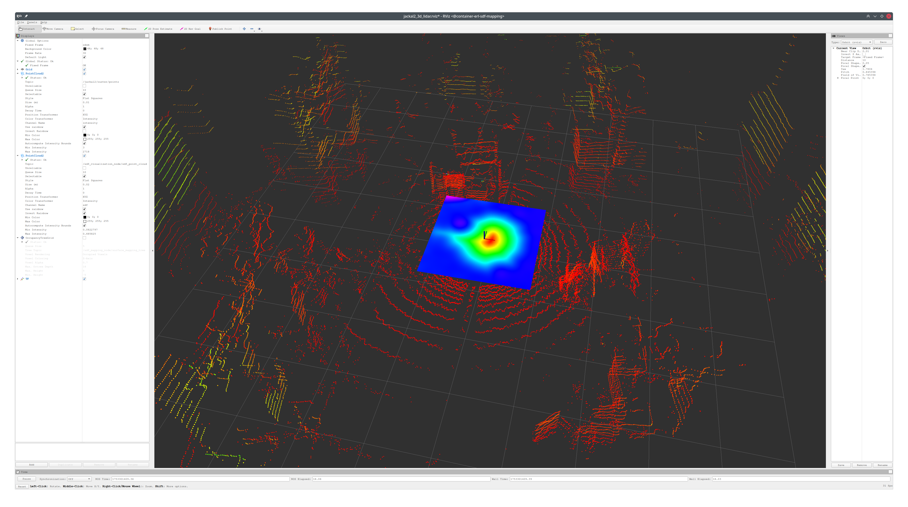
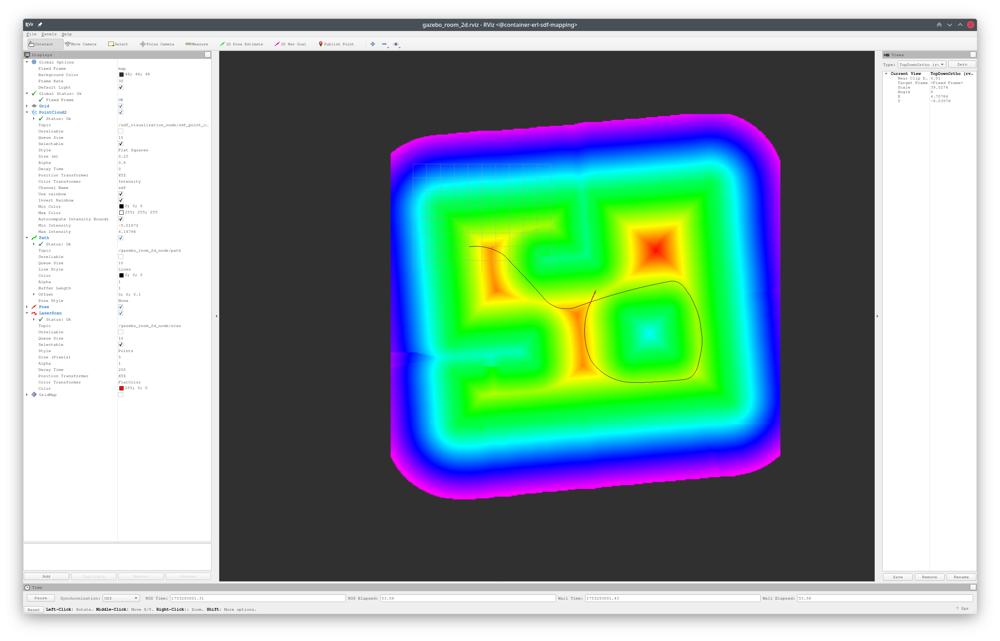
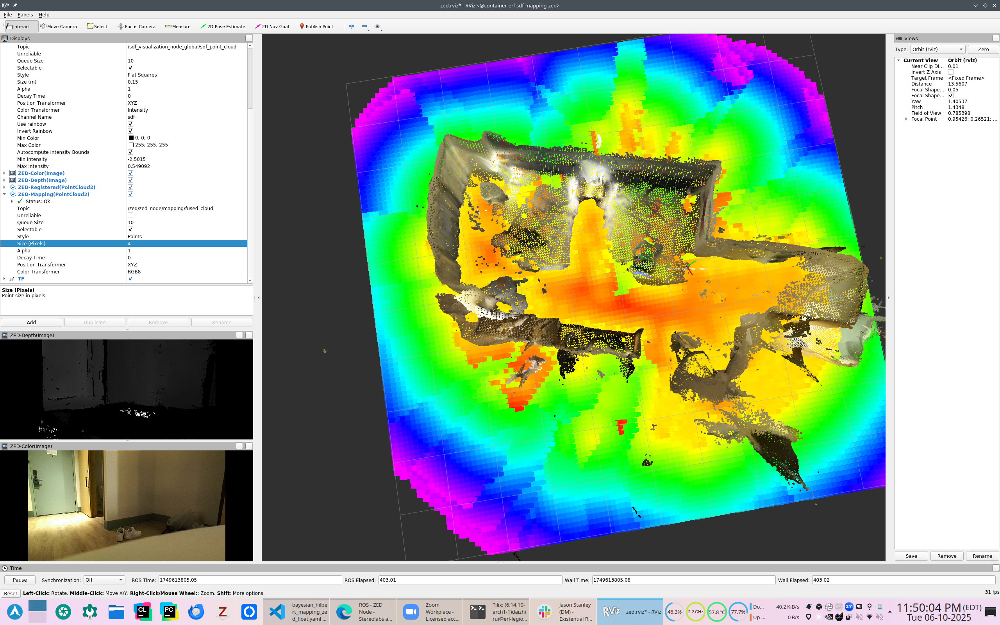
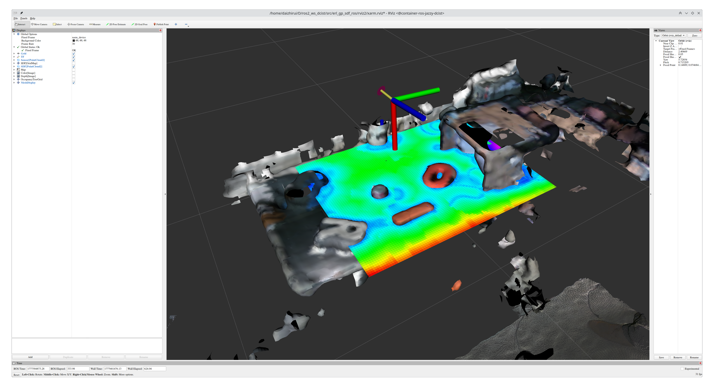

# erl_gp_sdf_ros

[](https://github.com/ExistentialRobotics/erl_gp_sdf_ros/tags)
[](https://opensource.org/licenses/MIT)
[](http://wiki.ros.org/)
[](https://docs.ros.org/)
[](https://docs.ros.org/)

|  |  |
| --- | --- |
|  |  |

**A ROS package for Gaussian Process regression on Signed Distance Fields.**

`erl_gp_sdf_ros` is a ROS wrapper package for the 🚪[erl_gp_sdf](https://github.com/ExistentialRobotics/erl_gp_sdf) library, providing nodes for real-time SDF mapping and visualization using Gaussian Process regression. The package supports both ROS1 (Noetic) and ROS2 (Humble) distributions.

## Features

- **SDF Mapping**: Real-time signed distance field estimation using Gaussian Process regression
- **Different Sensors**: Support for various sensor types (LiDAR, depth cameras, point clouds)
- **Visualization**: Real-time SDF visualization using grid maps and RViz
- **Mapping Quality**: Uncertainty-aware mapping with variance estimation
- **ROS Support**: Compatible with both ROS1 and ROS2
- **Multiple Demos**: Pre-configured demonstrations for different scenarios

## Getting Started

### Prerequisites

- ROS1 Noetic or ROS2 Humble
- C++17 compatible compiler
- CMake 3.24 or higher

### Create Workspace

```bash
mkdir -p <your_workspace>/src && \
vcs import --input https://raw.githubusercontent.com/ExistentialRobotics/erl_gp_sdf_ros/refs/heads/main/erl_gp_sdf_ros.repos <your_workspace>/src
```

### Dependencies

This package depends on the following ERL packages:
- [erl_cmake_tools](https://github.com/ExistentialRobotics/erl_cmake_tools)
- [erl_common](https://github.com/ExistentialRobotics/erl_common)
- [erl_common_ros](https://github.com/ExistentialRobotics/erl_common_ros)
- [erl_covariance](https://github.com/ExistentialRobotics/erl_covariance)
- [erl_gaussian_process](https://github.com/ExistentialRobotics/erl_gaussian_process)
- [erl_geometry](https://github.com/ExistentialRobotics/erl_geometry)
- [erl_geometry_msgs](https://github.com/ExistentialRobotics/erl_geometry_msgs)
- [erl_geometry_rviz_plugin](https://github.com/ExistentialRobotics/erl_geometry_rviz_plugin)
- [erl_geometry_ros](https://github.com/ExistentialRobotics/erl_geometry_ros)
- [erl_gp_sdf](https://github.com/ExistentialRobotics/erl_gp_sdf)
- [erl_gp_sdf_msgs](https://github.com/ExistentialRobotics/erl_gp_sdf_msgs)

```bash
# Ubuntu 20.04
wget -qO - https://raw.githubusercontent.com/ExistentialRobotics/erl_common/refs/heads/main/scripts/setup_ubuntu_20.04.bash | bash
wget -qO - https://raw.githubusercontent.com/ExistentialRobotics/erl_geometry/refs/heads/main/scripts/setup_ubuntu_20.04.bash | bash
# Ubuntu 22.04, 24.04
wget -qO - https://raw.githubusercontent.com/ExistentialRobotics/erl_common/refs/heads/main/scripts/setup_ubuntu_22.04_24.04.bash | bash
wget -qO - https://raw.githubusercontent.com/ExistentialRobotics/erl_geometry/refs/heads/main/scripts/setup_ubuntu_22.04_24.04.bash | bash
```

Standard ROS dependencies:
- `geometry_msgs`
- `sensor_msgs`
- `std_msgs`
- `grid_map_ros`
- `grid_map_msgs`
- `tf2_ros`
- `tf2_eigen`
- `tf2_geometry_msgs`

### Docker Option (Recommended)

The easiest way to get started is to use the provided [Docker files](./docker), which contains all dependencies.

```bash
cd <your_workspace>
ROS_DISTRO=<ros_distro> ./src/erl_gp_sdf_ros/scripts/build_docker.bash

# Create and enter container
./src/erl_gp_sdf_ros/scripts/create_container.bash
./src/erl_gp_sdf_ros/scripts/login_container.bash
```

### Building the Package

```bash
cd <your_workspace>
# for ROS1
catkin build erl_gp_sdf_ros
source devel/setup.bash
# for ROS2
colcon build --packages-up-to erl_gp_sdf_ros
source install/setup.bash
```

## Available Nodes

### 1. `sdf_mapping_node`

Performs real-time SDF mapping using Gaussian Process regression. The node subscribes to sensor data, maintains a probabilistic surface mapping, and provides an SDF query service.

**Subscribed Topics (one of the following for sensor data):**
- Laser scan topic (sensor_msgs/LaserScan): 2D laser scan data
- Point cloud topic (sensor_msgs/PointCloud2): 3D point cloud data
- Depth image topic (sensor_msgs/Image): Depth camera images
- Odometry topic (nav_msgs/Odometry or geometry_msgs/TransformStamped): Robot pose (optional)

**Published Topics:**
- `surface_mapping_tree` (erl_geometry_msgs/OccupancyTreeMsg): Occupancy tree used by surface mapping (optional)
- `surface_points` (sensor_msgs/PointCloud2): Surface points with position, normal, and variance information (optional)
- `update_time` (sensor_msgs/Temperature): Time taken for map updates (for performance monitoring)
- `query_time` (sensor_msgs/Temperature): Time taken for SDF queries (for performance monitoring)

**Published Services:**
- `sdf_query` (erl_gp_sdf_msgs/SdfQuery): Query SDF values, gradients, and uncertainties at specified points
- `occ_query` (erl_gp_sdf_msgs/OccQuery): Query occupancy probabilities (or log-odds) and their gradients at specified points
- `save_map` (erl_gp_sdf_msgs/SaveMap): Save the current SDF map to file

**Key Parameters:**

*Core Configuration:*
- `setting_file` (string): Optional YAML file to load all parameters from (default: "")
- `map_dim` (int): Map dimensionality, 2 for 2D or 3 for 3D mapping (default: 3)
- `double_precision` (bool): Whether to use double precision floating point (default: false)
- `surface_mapping_setting_type` (string): Class name for surface mapping setting (required)
- `surface_mapping_setting_file` (string): Path to surface mapping configuration file (required)
- `surface_mapping_type` (string): Surface mapping algorithm class name (required)
- `sdf_mapping_setting_file` (string): Path to SDF mapping configuration file (required)

*Sensor Configuration:*
- `scan_topic` (string): Topic name for sensor data (default: "/front/scan")
- `scan_type` (string): Sensor message type - "laser", "point_cloud", or "depth" (default: "laser")
- `scan_frame_type` (string): Scan frame class name (e.g., "erl::geometry::LidarFrame3D<float>")
- `scan_frame_setting_file` (string): Path to scan frame configuration file
- `scan_stride` (int): Downsampling factor for scan data (default: 1)
- `convert_scan_to_points` (bool): Whether to convert non-point cloud scans to points (default: false)
- `scan_in_local_frame` (bool): Whether scan data is in sensor's local frame (default: false)
- `depth_scale` (float): Scale factor for depth images, e.g., 0.001 converts mm to m (default: 0.001)

*Frame Configuration:*
- `world_frame` (string): World coordinate frame (default: "map")
- `sensor_frame` (string): Sensor coordinate frame (default: "front_laser")

*Odometry Configuration:*
- `use_odom` (bool): Whether to use odometry for sensor pose (default: false)
- `odom_topic` (string): Odometry topic name (default: "/jackal_velocity_controller/odom")
- `odom_msg_type` (string): Odometry message type - "odometry" or "transform_stamped" (default: "odometry")
- `odom_queue_size` (int): Size of odometry message queue (default: 100)

*Publishing Configuration:*
- `publish_tree` (bool): Whether to publish occupancy tree (default: false)
- `publish_tree_topic` (string): Topic name for occupancy tree (default: "surface_mapping_tree")
- `publish_tree_binary` (bool): Whether to use binary format for tree messages (default: true)
- `publish_tree_frequency` (double): Publishing frequency for occupancy tree in Hz (default: 5.0)
- `publish_surface_points` (bool): Whether to publish surface points (default: false)
- `publish_surface_points_topic` (string): Topic name for surface points (default: "surface_points")
- `publish_surface_points_frequency` (double): Publishing frequency for surface points in Hz (default: 5.0)

*Unobserved Space Configuration:*

By default, every output of this node reports space it has never seen as if it were free. `occ_query`
returns whatever the mapping frontend uses as its prior for unknown space (`unknown_log_odds` in the
surface mapping setting, usually a free prior); `sdf_query` returns a distance from `Test()` that
carries no support at all where no GP was found; and the projected occupancy grid returns `-1`, which
many planners are configured to treat as traversable. A planner consuming any of them will happily
route straight through unmapped space. The `unobserved_space` parameter group changes that, and
applies to all three outputs at once:

- `unobserved_space.mode` (string): How unobserved space is reported (default: `"prior"`)
  - `"prior"`: report whatever the mapping frontend leaves there (previous behavior)
  - `"unknown"`: NaN from the query services — `occ_visualization_node` publishes NaN as `-1` — and
    `-1` in the projected occupancy grid, the value nav2 interprets as unknown
  - `"occupied"`: report fully occupied, so planners refuse to route through space that has never
    been seen
  - `"free"`: report fully free

*Occupancy (`occ_query`):*

- `unobserved_space.uncertainty_threshold` (double): Cells whose occupancy probability is within
  this margin of 0.5 are also reported according to `mode`, i.e. they are too uncertain to be
  trusted as an observation. Must be in `[0, 0.5]`. Cells that were never observed at all are
  detected independently of this value, so the default of `0.0` reports only those (default: 0.0)
- `unobserved_space.saturated_log_odds` (double): Magnitude of the log-odds reported for an
  unobserved cell when `mode` is `"occupied"` or `"free"` and the query is made in `"logodd"` mode.
  `"prob"` mode reports 1.0 / 0.0 instead (default: 100.0)

Both frontends detect unobserved cells exactly, from the absence of a node in the occupancy tree.
`BayesianHilbertSurfaceMapping` exposes no per-point observation flag through `Predict()` — it
silently leaves unobserved points at the prior it pre-fills them with, which is indistinguishable
from a real prediction of the same value — so the node repeats `Predict()`'s own tree lookup to
identify them.

*SDF (`sdf_query`):*

- `unobserved_space.sdf_variance_threshold` (double): Distance variance at or above which a
  prediction is not trusted as an observation, and is reported according to `mode`. Query points the
  mapper found no usable GP for come back at its sentinel variance of `1e6` (divided by the surface
  mapping `scaling` squared), so any value below that catches them; lower it to also reject
  predictions that are merely uncertain (default: 1.0e5)
- `unobserved_space.occupied_sdf` (double): Signed distance reported for an unobserved point when
  `mode` is `"occupied"`. Negative places the point inside an obstacle (default: -1.0)
- `unobserved_space.free_sdf` (double): Signed distance reported for an unobserved point when `mode`
  is `"free"` (default: 1.0e3)

The `uncertainty_threshold` above is an occupancy-probability margin and does not apply to the SDF;
`sdf_variance_threshold` is the SDF's uncertainty knob. Neither applies to the projected occupancy
grid, which carries no per-cell uncertainty — there `mode` alone decides how its unknown cells are
published.

### 2. `sdf_visualization_node`

Provides visualization of SDF maps by querying the SDF mapping service and publishing results as grid maps and point clouds.

**Services Used:**
- SDF query service (erl_gp_sdf_msgs/SdfQuery): Queries SDF values from the mapping node

**Published Topics:**
- Grid map topic (grid_map_msgs/GridMap): SDF values, gradients, and uncertainties as grid map layers (optional)
- Point cloud topic (sensor_msgs/PointCloud2): SDF visualization as colored point cloud (optional)

**Key Parameters:**
- `resolution` (double): Grid resolution for visualization (default: 0.1)
- `x_cells` (int): Number of grid cells in X direction (default: 101, must be odd)
- `y_cells` (int): Number of grid cells in Y direction (default: 101, must be odd)
- `x`, `y`, `z` (double): Grid center position (default: 0.0)
- `service_name` (string): Name of SDF query service (default: "sdf_query")
- `map_topic_name` (string): Topic name for grid map output (default: "sdf_grid_map")
- `point_cloud_topic_name` (string): Topic name for point cloud output (default: "sdf_point_cloud")
- `publish_grid_map` (bool): Whether to publish grid map (default: true)
- `publish_point_cloud` (bool): Whether to publish point cloud (default: true)
- `publish_gradient` (bool): Whether to include gradient information (default: false)
- `publish_sdf_variance` (bool): Whether to include SDF variance (default: false)
- `publish_gradient_variance` (bool): Whether to include gradient variance (default: false)
- `publish_covariance` (bool): Whether to include covariance information (default: false)
- `attached_to_frame` (bool): Whether visualization follows a moving frame (default: false)
- `attached_frame` (string): Frame to follow when attached_to_frame is true (default: "map")
- `world_frame` (string): World coordinate frame (default: "map")
- `publish_rate` (double): Visualization update frequency in Hz (default: 2.0)

## Usage Examples

Each demo is started from a single launch file. The tables below list the launch arguments a user
typically needs to set. Most defaults are sensible, but the **dataset-path arguments must be overridden**.

Arguments are passed as `arg:=value`, for example:

```bash
# ROS1
roslaunch erl_gp_sdf_ros cow_and_lady.launch open_rqt_plot:=false
# ROS2
ros2 launch erl_gp_sdf_ros cow_and_lady.launch.py open_rqt_plot:=false
```

### Common Launch Arguments

Shared by most demos, with identical names in ROS1 and ROS2:

| Argument  | Default  | Description  |
| --- | --- | --- |
| `precision`  | `float`  | Floating-point precision: `float` or `double`.  |
| `surf_mapping_method` | `bayesian_hilbert` | Surface mapping method: `bayesian_hilbert` or `gp_occ`.  |
| `visualize_sdf`  | `true`  | Launch the SDF visualization node.  |
| `open_rviz`  | `true`  | Launch RViz with a preconfigured view.  |
| `open_rqt_plot`  | `true` / `false`  | Launch `rqt_plot` to monitor update/query time (demo-specific). |
| `play_rosbag`  | demo-specific  | Whether to play the dataset rosbag (dataset demos only).  |
| `rosbag_play_rate`  | demo-specific  | Rosbag playback rate.  |

### Dataset-Path Arguments (must be provided)

Override the argument below for your setup. Note that the argument **name differs between ROS1
and ROS2** for some demos:

| Demo  | ROS1 argument(s)  | ROS2 argument(s)  | Points to  |
| --- | --- | --- | --- |
| Cow and Lady  | `cow_and_lady_bag`, `gt_point_cloud_file` | `cow_and_lady_bag`, `gt_point_cloud_file` | ROS bag + ground-truth `.ply`  |
| Jackal 2D LiDAR  | `bag_file`  | `rosbag_dir`  | ROS bag  |
| Jackal 3D LiDAR  | `bag_file`  | `rosbag_dir`  | ROS bag  |
| Newer College (ROS1)  | `bag_file`  | —  | ROS bag  |
| ZED Camera  | `zed_bag_file`  | `zed_bag_dir`  | ROS bag  |

> **Gazebo Room 2D** needs no external data — it generates synthetic scans from `erl_geometry`
> and runs out of the box. **xArm** expects a live camera/robot publishing the configured
> topics rather than a rosbag.

### 1. Gazebo Room 2D Simulation



Launch the 2D room simulation with SDF mapping:

```bash
# ROS1
roslaunch erl_gp_sdf_ros gazebo_room_2d.launch

# ROS2
ros2 launch erl_gp_sdf_ros gazebo_room_2d.launch.py
```

This demonstration shows SDF mapping in a simulated 2D environment with synthetic laser scan
data. No dataset path is required — it runs out of the box.

### 2. Cow and Lady Dataset


Launch the Cow and Lady dataset visualization:

```bash
# ROS1 (cow_and_lady_bag points to a .bag file)
roslaunch erl_gp_sdf_ros cow_and_lady.launch \
    cow_and_lady_bag:=/path/to/cow_and_lady.bag \
    gt_point_cloud_file:=/path/to/cow_and_lady_gt.ply

# ROS2 (cow_and_lady_bag points to a ROS2 bag directory)
ros2 launch erl_gp_sdf_ros cow_and_lady.launch.py \
    cow_and_lady_bag:=/path/to/cow_and_lady_ros2_bag \
    gt_point_cloud_file:=/path/to/cow_and_lady_gt.ply
```

**Required launch arguments:**
- `cow_and_lady_bag`: Path to the dataset bag (a `.bag` file for ROS1, a bag directory for ROS2)
- `gt_point_cloud_file`: Path to the ground-truth point cloud (`.ply`)

### 3. Jackal 3D LiDAR Demo


Launch the 3D LiDAR mapping demonstration:

```bash
# ROS1 (bag_file points to a .bag file)
roslaunch erl_gp_sdf_ros jackal_3d_lidar.launch bag_file:=/path/to/jackal_3d.bag

# ROS2 (rosbag_dir points to a bag directory; play_rosbag defaults to false)
ros2 launch erl_gp_sdf_ros jackal_3d_lidar.launch.py \
    rosbag_dir:=/path/to/jackal_3d_ros2_bag play_rosbag:=true
```

This demo shows 3D SDF mapping using LiDAR data from a Jackal robot.

**Required launch arguments:**
- `bag_file` (ROS1) / `rosbag_dir` (ROS2): Path to the recorded LiDAR rosbag
- `play_rosbag` (ROS2): set to `true` to replay the bag (defaults to `false`)

### 4. ZED Camera Demo



Launch the ZED stereo camera demonstration:

```bash
# ROS1 (zed_bag_file points to a .bag file)
roslaunch erl_gp_sdf_ros zed_camera.launch zed_bag_file:=/path/to/zed.bag

# ROS2 (zed_bag_dir points to a bag directory)
ros2 launch erl_gp_sdf_ros zed_camera.launch.py zed_bag_dir:=/path/to/zed_ros2_bag
```

This demo demonstrates SDF mapping using depth data from a ZED stereo camera.

**Required launch arguments:**
- `zed_bag_file` (ROS1) / `zed_bag_dir` (ROS2): Path to the recorded ZED rosbag
- Set `play_rosbag:=false` to run against a live ZED camera instead of a rosbag

#### 5. xArm Robot Demo



Launch the xArm robot demonstration:

```bash
# ROS1
roslaunch erl_gp_sdf_ros xarm.launch
# ROS2
ros2 launch erl_gp_sdf_ros xarm.launch.py
```

This demo expects a live camera/robot publishing the configured topics (no rosbag argument).
Common arguments: `visualize_sdf`, `open_rviz` (both ROS1/ROS2), plus `use_sim_time` and
`log_level` (ROS2).

## RViz Configurations

Pre-configured RViz files are available in the `rviz/` directory for ROS1 or `rviz2/` for ROS2:
- `gazebo_room_2d.rviz`: Configuration for 2D simulation
- `cow_and_lady.rviz`: Configuration for Cow and Lady dataset
- `jackal2_3d_lidar.rviz`: Configuration for 3D LiDAR visualization
- `zed.rviz`: Configuration for camera-based mapping
- `xarm.rviz`: Configuration for xArm robot mapping

## Docker Usage

We provide Dockerfiles for different ROS distributions in the [docker](./docker) directory. Please
run the `build.bash` script along with the Dockerfile to build the image you need.

## License

This project is licensed under the MIT License - see the [LICENSE](LICENSE) file for details.

## Acknowledgements

This work was supported by [ARL DCIST CRA](https://www.dcist-cra.org/) W911NF-17-2-0181, NSF FRR CAREER 2045945, the Ministry of Trade, Industry, and Energy (MOTIE), Korea, under the Strategic Technology Development Program supervised by the Korea Institute for Advancement of Technology (KIAT) [Grant No. P0026052], and the Korea Institute of Planning and Evaluation for Technology in Food, Agriculture, Forestry (IPET) through the Smart Farm Innovation Technology Development Program, funded by the Ministry of Agriculture, Food and Rural Affairs (MAFRA) (RS-2025-02219411).